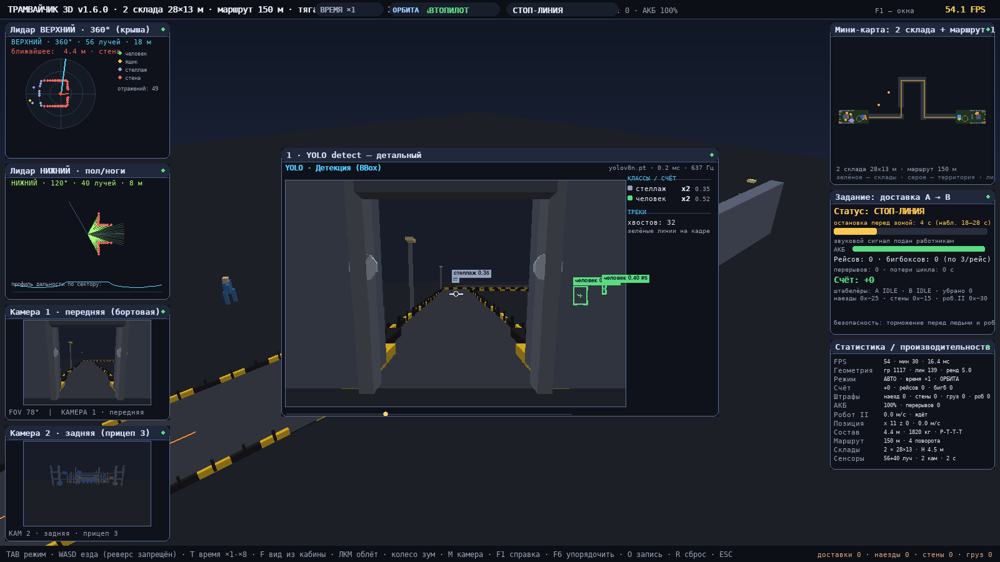
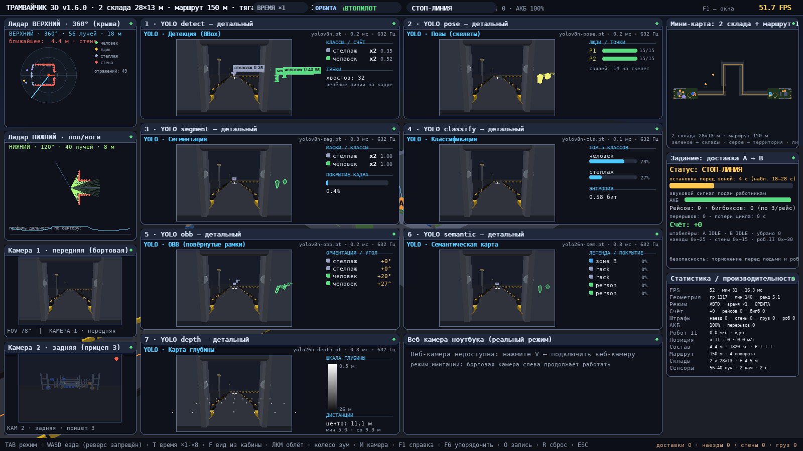

# Трамвайчик 3D



Все 16 окон одновременно (сетка YOLO 1–7 + веб-камера в центре):



Простой **программный 3D-движок** (без OpenGL — чистый pygame + numpy) и
симуляция производства: **ДВА одинаковых склада** (28 × 13 × 4,5 м,
по чертежу из наблюдений) соединены **маршрутом длиной 150 м с 4 поворотами**,
огороженным чёрно-жёлтыми барьерами. **Робот-тягач с 3 вагонами** (Р-Т-Т-Т,
спецификация RoboCV) возит бигбоксы: погрузка на площадке склада A →
150 м по территории → разгрузка на площадке склада B → **разворот по малому
кругу** → обратный рейс. Реверс запрещён: S — только тормоз, поэтому разворот
возможен только по малому кругу в зонах погрузки/выгрузки. ШТРАФНЫЕ ОЧКИ:
за рейс +100, наезд на работника −25, кузов о стену/стеллаж −15, груз ударил
работника −20, груз о стену/стеллаж −10, столкновение с роботом II −30.
Состав оборудован **двумя лидарами** (верхний 360° на мачте + нижний 120°)
и **двумя камерами** (передняя + задняя) с выводом изображения. Поверх сцены —
**перетаскиваемые окна** с адаптивной раскладкой; размер сетки YOLO-окон
подстраивается под число открытых панелей.

## Возможности

| Блок | Что умеет |
|------|-----------|
| 3D-движок | программный рендер (painter's algorithm, корректный backface cull, near-clip, двухсветное освещение); bbox-отсечение мешей, чанки статики, отдельные меши барьеров, дальность отрисовки 42 м — 60+ FPS |
| Состав | тягач + 3 вагона по «следу» (breadcrumb), реверс запрещён, масса в физике, маячок, сцепки |
| Автопилот | фиксированный маршрут миссии (малые круги → ворота → 150 м → малые круги), стоп-линия, операции, экстренное торможение перед работниками и роботом II, фьюжн с верхним лидаром |
| Ручной режим | WASD/стрелки, ПРОБЕЛ — стоп, TAB — переключение |
| Сенсоры | верхний лидар 360° (56 лучей, 18 м) + нижний 120° (40 лучей, 8 м, видит ограждения) с радар-окнами и лучами в 3D; камеры передняя/задняя |
| 7 задач YOLO | детальные панели 1–7: detect/pose/segment/classify/obb/semantic/depth из ground-truth кадра бортовой камеры + метрики модели |
| Очки | +100 рейс; −25 наезд; −15 стена/ограждение; −20 груз→работник; −10 груз→стена; −30 робот II |
| Наблюдения | стоп-линия, сигнал, рейс=3 бигбокса, синие тележки, перерыв +5 мин, АКБ, мусор, робот II, штабелёры |
| Веб-камера | реальный режим ноутбука, запись датасета YOLO-формата (клавиша O), train_finetune.py |

## Управление

| Клавиша | Действие |
|---------|----------|
| TAB | автопилот / ручной режим |
| W / ↑ | газ (вперёд, макс 2,2 м/с) |
| S / ↓, ПРОБЕЛ | тормоз / стоп (реверс запрещён) |
| A / D | поворот (в ручном режиме) |
| **T** | **ускорение времени ×1/×2/×4/×8** |
| **F** | **вид: орбита → следящая → кабина (1-е лицо)** |
| M | следящая/свободная камера (в режиме орбиты) |
| R | сброс состава на площадку A |
| ЛКМ / колесо | облёт сцены / зум (в режиме орбиты) |
| F1 | справка · F2 статистика · F3 мини-карта · F4 задание · F6 упорядочить окна |
| 8 / 9 | лидар верхний / нижний · C / X — камеры 1/2 |
| 1..7 | панели YOLO (по умолчанию открыта только №1) · V — веб-камера |
| O | запись датасета · F11 — полный экран |

## Запуск

```bash
pip install -r requirements.txt   # pygame, numpy; opencv/torch/ultralytics — опционально
python main.py                    # два склада и маршрут 150 м, автопилот включён
python main.py --selftest         # headless-самопроверка + FPS
```

Опционально: `python main.py --width 1920 --height 1080`.

## Тесты

```bash
python main.py --selftest         # FPS + полный прогон сенсоров (headless)
python scripts/test_v160.py       # ~45 проверок (два склада, 150 м, круги,
                                  #   штабелёры, ускорение, вид из кабины)
python scripts/test_v150.py       # склад, RoboCV, наблюдения, робот II
python scripts/test_v140.py       # штрафы кузова/груза (регресс)
python scripts/test_v130.py       # состав/реверс/наезды (регресс)
python scripts/test_v120.py       # лидары/камеры/панели (регресс)
python scripts/test_layout.py     # адаптивная раскладка, 58 проверок
python tests/test_long.py         # 2 полных рейса A→B→A, датасет, A*
```

## Структура проекта

```
tramchik3d/
├── main.py               # приложение: цикл, ускорение времени, виды камеры, самотест
├── config.py             # ВСЕ параметры: 2 склада, маршрут 150 м, RoboCV, штрафы
├── engine/               # 3D-движок: renderer (корректный cull + fill-свет), mesh, camera
├── sim/
│   ├── world.py          # МИР: два склада + коридор 150 м (ограждения, разметка, вехи)
│   ├── tram.py           # тягач + 3 вагона: маршрут миссии, малые круги, физика, счёт
│   ├── stacker.py        # штабелёры A/B: возят/убирают груз с площадок (v1.6.0)
│   ├── npc.py            # робот II: кольцо островов, уступает, анти-дедлок
│   ├── lidar.py          # 2 лидара: prefilter по дальности, стены/ограждения
│   ├── nav.py            # сетка всего мира (137×45 м) + A* + сглаживание
│   └── pedestrians.py    # работники: роам-зоны по складам/территории, перерыв
├── perception/
│   ├── sim_perception.py # 7 задач YOLO из ground truth (+ робот II, штабелёры)
│   └── webcam.py         # веб-камера, реальный YOLO, запись датасета
├── ui/
│   ├── windows.py        # оконный менеджер (redraw_every у каждого окна)
│   └── panels.py         # адаптивная сетка YOLO, компактная статистика, карта мира
├── scripts/              # тесты v1.2–v1.6, диагностика, скриншоты
├── tests/test_long.py    # долгий прогон (рейсы, датасет, A*)
└── train_finetune.py     # дообучение YOLO на собранном датасете
```

## Производительность

| Конфигурация | FPS (headless-песочница) | FPS (рабочая машина) |
|---|---|---|
| prod (8 окон по умолчанию, ×1) | ~55–60 | 60+ |
| стресс (все 16 окон + время ×4) | ~32–35 | ~45+ |

Если нужно больше — `config.RENDER_SCALE = 0.85`.